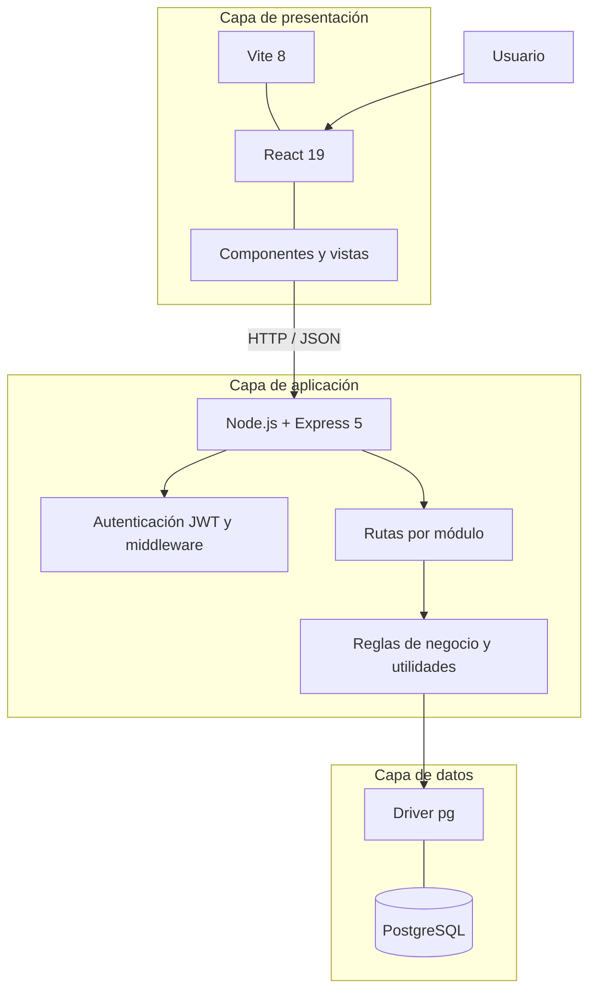

# Arquitectura y ambiente — Inventario Óptica

## 1. Arquitectura general

El sistema utiliza una arquitectura cliente-servidor dividida en tres capas:

1. **Presentación:** frontend web desarrollado con React y Vite.
2. **Aplicación:** backend desarrollado con Node.js y Express. Recibe solicitudes HTTP, valida datos, aplica reglas de negocio y controla el acceso.
3. **Datos:** PostgreSQL. Almacena usuarios, productos, inventario, clientes, ventas y demás información del sistema.

El frontend no se conecta directamente a PostgreSQL. Todas las operaciones de datos pasan por la API del backend.

## 2. Diagrama de componentes y capas



Flujo resumido: el usuario interactúa con React; React envía solicitudes HTTP a Express; el backend autentica y valida; las consultas se ejecutan en PostgreSQL mediante `pg`; el backend devuelve respuestas JSON al frontend.

## 3. Tecnologías y versiones declaradas

Las siguientes versiones son los rangos declarados en los `package.json` del proyecto revisado. El prefijo `^` indica un rango compatible, no necesariamente la versión exacta instalada en el equipo.

| Componente | Tecnología | Versión declarada |
|---|---|---|
| Lenguaje frontend | JavaScript | ESM en frontend |
| UI | React | `^19.2.8` |
| DOM React | React DOM | `^19.2.8` |
| Herramienta frontend | Vite | `^8.3.0` |
| Plugin Vite | `@vitejs/plugin-react` | `^6.1.1` |
| Runtime backend | Node.js | No fijado en `package.json`; confirmar versión instalada en el equipo |
| Framework backend | Express | `^5.3.0` |
| Motor de base de datos | PostgreSQL | Versión no fijada en los archivos del proyecto; confirmar en el servidor |
| Driver PostgreSQL | `pg` | `^8.23.1` |
| Autenticación | `jsonwebtoken` | `^9.0.3` |
| Hash de contraseñas | `bcryptjs` | `^3.0.3` |

**Puertos usados en desarrollo:**

| Servicio | Puerto | Dirección local |
|---|---:|---|
| Frontend Vite | `5173` | `http://localhost:5173` |
| Backend Express | `3000` | `http://localhost:3000` |
| PostgreSQL | `5432` por defecto | Host local configurado en `.env` |

PostgreSQL puede utilizar otro puerto si el servidor está configurado así; el valor debe coincidir con `DB_PORT`.

## 4. Dependencias del proyecto

### Backend — `backend/package.json`

**Dependencias de ejecución:**

| Paquete | Versión declarada | Uso |
|---|---|---|
| `bcryptjs` | `^3.0.3` | Comparar y generar hashes de contraseñas. |
| `cors` | `^2.8.6` | Configurar orígenes permitidos. |
| `dotenv` | `^18.0.8` | Cargar variables desde `.env`. |
| `express` | `^5.3.0` | Framework HTTP y API. |
| `express-rate-limit` | `^8.7.1` | Limitar frecuencia de solicitudes. |
| `express-validator` | `^7.3.2` | Validar datos de entrada. |
| `helmet` | `^8.3.0` | Encabezados HTTP de seguridad. |
| `jsonwebtoken` | `^9.0.3` | Crear y verificar JWT. |
| `pg` | `^8.23.1` | Conectar con PostgreSQL. |

**Dependencia de desarrollo:**

| Paquete | Versión declarada | Uso |
|---|---|---|
| `nodemon` | `^3.1.14` | Reiniciar el backend al detectar cambios. |

### Frontend — `frontend/package.json`

**Dependencias de ejecución:**

| Paquete | Versión declarada | Uso |
|---|---|---|
| `react` | `^19.2.8` | Biblioteca de interfaz. |
| `react-dom` | `^19.2.8` | Renderizado de React en el navegador. |

**Dependencias de desarrollo:**

| Paquete | Versión declarada |
|---|---|
| `@eslint/js` | `^10.0.1` |
| `@types/react` | `^19.2.18` |
| `@types/react-dom` | `^19.2.7` |
| `@vitejs/plugin-react` | `^6.1.1` |
| `eslint` | `^10.10.0` |
| `eslint-plugin-react-hooks` | `^7.1.1` |
| `eslint-plugin-react-refresh` | `^0.5.6` |
| `globals` | `^17.12.0` |
| `vite` | `^8.3.0` |

Los archivos `package-lock.json` registran el árbol de dependencias resuelto. Para instalar versiones consistentes se recomienda ejecutar `npm ci` en cada carpeta.

## 5. Estructura de carpetas

```text
Inventario Optica React/
├── backend/
│   ├── middleware/
│   │   └── authMiddleware.js
│   ├── routes/
│   ├── utils/
│   ├── crearAdmin.js
│   ├── database.js
│   ├── server.js
│   ├── package.json
│   └── package-lock.json
│
├── frontend/
│   ├── public/
│   ├── src/
│   │   ├── components/
│   │   ├── css/
│   │   ├── assets/
│   │   ├── api.js
│   │   └── sesion.js
│   ├── package.json
│   └── package-lock.json
│
├── README.md
├── README_INSTALACION.md
└── README_ARQUITECTURA.md
```

### Responsabilidad de carpetas y archivos

- `backend/server.js`: configura Express, seguridad, CORS, límites de solicitudes y rutas.
- `backend/database.js`: crea el pool de conexiones PostgreSQL a partir de variables de entorno.
- `backend/routes/`: endpoints organizados por módulos.
- `backend/middleware/`: autenticación y autorización.
- `backend/utils/`: funciones auxiliares compartidas.
- `backend/crearAdmin.js`: script interactivo para crear un administrador asociado a `id_tenant = 1`.
- `frontend/src/components/`: componentes y pantallas.
- `frontend/src/api.js`: comunicación del frontend con la API.
- `frontend/src/sesion.js`: utilidades de sesión.

## 6. Variables de entorno

El backend lee las siguientes variables desde `backend/.env`:

| Variable | Obligatoria en la configuración | Descripción | Ejemplo no secreto |
|---|---|---|---|
| `PORT` | No; por defecto `3000` | Puerto del backend. | `3000` |
| `FRONTEND_URL` | Sí para CORS | Origen autorizado del frontend. | `http://localhost:5173` |
| `DB_HOST` | Sí | Host PostgreSQL. | `localhost` |
| `DB_PORT` | No; por defecto `5432` | Puerto PostgreSQL. | `5432` |
| `DB_NAME` | Sí | Nombre de la base de datos. | `inventario_optica` |
| `DB_USER` | Sí | Usuario de PostgreSQL. | `postgres` |
| `DB_PASSWORD` | Sí | Contraseña de PostgreSQL. | No publicar |
| `JWT_SECRET` | Sí | Secreto de firma JWT, mínimo 32 caracteres. | No publicar |

Ejemplo de plantilla para `backend/.env.example`:

```env
PORT=3000
FRONTEND_URL=http://localhost:5173
DB_HOST=localhost
DB_PORT=5432
DB_NAME=NOMBRE_DE_LA_BASE
DB_USER=USUARIO_POSTGRES
DB_PASSWORD=CAMBIAR_LOCALMENTE
JWT_SECRET=CAMBIAR_POR_UN_SECRETO_ALEATORIO_DE_32_CARACTERES_O_MAS
```

`backend/.env.example` es una plantilla; cada equipo debe crear su propio `backend/.env`. Nunca subir el `.env` real a GitHub.

El frontend revisado define en `Login.jsx` la URL de API `http://localhost:3000/api/auth` y envía `tenant_id: 1`. Si cambia el puerto, el host o el tenant, debe actualizarse la configuración del frontend de forma coherente.

## 7. Base de datos y script SQL

- Motor: PostgreSQL.
- Puerto habitual: `5432`.
- Driver de Node.js: `pg`.
- El backend obtiene host, puerto, nombre de base, usuario y contraseña desde las variables de entorno.
- El esquema revisado contiene entidades para tenant, usuarios, categorías, proveedores, productos, atributos de lentes, servicios, clientes, ventas, detalle de ventas, movimientos, detalle de movimientos, abonos, cuotas, gastos y recetas.

### Script SQL requerido para instalar en otro equipo

La entrega debe incluir el script o respaldo oficial compatible con el código, por ejemplo:

```text
database/
└── crear_bd.sql
```

**Pendiente de la entrega revisada:** el ZIP del proyecto inspeccionado no contenía el script SQL. Por ello, no se puede afirmar que el repositorio, por sí solo, permita crear la base desde cero. El responsable debe incorporar el script oficial, revisar que no contenga información personal o contraseñas reales y documentar el procedimiento de restauración.

No confundir el script de estructura con un script de datos ficticios. Los datos de demostración solo deben restaurarse en una base de pruebas independiente.

### Precaución con la base original

La base original de la óptica debe conservarse. Antes de cualquier migración o modificación:
1. Realizar respaldo.
2. Revisar el SQL.
3. Probarlo en una base independiente.
4. Autorizar su aplicación.

## 8. Autenticación y permisos

El flujo de inicio de sesión revisado:

1. El frontend envía `tenant_id`, correo y contraseña a `/api/auth/login`.
2. El backend busca al usuario dentro del tenant indicado.
3. `bcryptjs` compara la contraseña con `password_hash`.
4. Si el usuario está activo y las credenciales son correctas, se firma un JWT.
5. El middleware valida el token en rutas privadas.

El token contiene identificador de usuario, tenant y rol, con expiración de una hora. Los roles identificados en el código son `admin`, `optometrista` y `empleado`.

### Cuentas identificadas en la base original

La tabla `usuario` de la base `optica` contiene estas cuentas activas, asociadas a `id_tenant = 1`:

| Rol | Correo | Estado |
|---|---|---|
| `admin` | `admin@ocadhas.com` | `activo` |
| `empleado` | `dayen5525@gmail.com` | `activo` |

La consulta no permite conocer ni confirmar las contraseñas. No se documentan contraseñas en el repositorio.

El código de inicio de sesión del frontend utiliza actualmente `tenant_id: 1`; ese valor debe corresponder al tenant correcto en la base conectada.

## 9. Módulos funcionales

El backend registra rutas para autenticación, balance, cartera, clientes, configuración, costos, crédito, inicio, inventario, movimientos, productos y ventas.

El código revisado permite roles `admin` y `empleado` en inventario y ventas; los demás módulos privados listados están restringidos a `admin`. Confirmar estos permisos mediante pruebas en la versión desplegada localmente.

## 10. Reglas de datos observadas y puntos de validación

- Las tablas `tenant` y `usuario` utilizan `id_tenant`; no asumir columnas llamadas `id` o `tenant_id` en PostgreSQL.
- El esquema revisado incluye funciones y triggers para aplicar movimientos y actualizar existencias y totales.
- El detalle de venta genera movimientos de salida, pero la función revisada excluye productos de tipo `LENTE`. Debe comprobarse el tratamiento de stock para lentes.
- La ruta `/api/auth/registro` revisada presenta incompatibilidad entre nombres de columnas usados por el código y los definidos en el esquema. Corregir y probar antes de habilitar registro.

## 11. Ambiente de ejecución actual

El sistema no está desplegado en internet. Se ejecuta localmente:

- Frontend: `http://localhost:5173`
- Backend: `http://localhost:3000`
- PostgreSQL: `localhost:5432` (si se mantiene la configuración local por defecto).

Las direcciones `localhost` no son URL públicas. Para acceder desde otro equipo se requiere configurar red, servidor y seguridad; eso no forma parte del despliegue actual.

## 12. Alcance y mantenimiento de este documento

Las versiones de librerías se transcriben de los `package.json` revisados. Las versiones exactas de Node.js y PostgreSQL deben registrarse desde el equipo donde se ejecuta el sistema. La documentación refleja el código y esquema examinados; no reemplaza las pruebas de integración ni certifica que todos los módulos estén terminados.
